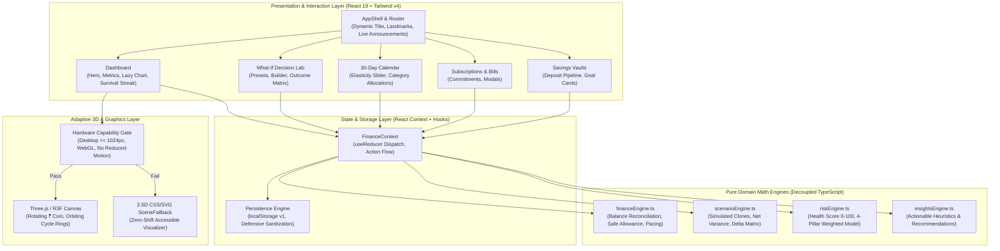

# 🏗️ RupeeFlow System Architecture

> **RupeeFlow** is built with a strictly decoupled, layered frontend architecture designed for mathematical determinism, offline resilience, zero-layout-shift rendering, and WCAG 2.2 AA accessibility.

---

## 📐 High-Level Architecture Diagram

---

## 🧱 Architectural Layers

### 1. Pure Domain Math Engines (`src/finance/`)
All financial logic is strictly separated from React components into zero-dependency, pure TypeScript functions:
- **`financeEngine.ts`**: Implements deterministic balance reconciliation:
  $$\text{Cash Balance} = \text{Opening} + \text{Income} - \text{Expenses} - \text{Savings Transfers}$$
  $$\text{Safe Daily Allowance} = \frac{\text{Available Discretionary Funds}}{\text{Remaining Cycle Days}}$$
- **`scenarioEngine.ts`**: Runs non-destructive What-If simulations by deep-cloning current state, injecting hypothetical transactions/commitments, and computing multi-dimensional deltas without mutating actual user data.
- **`riskEngine.ts`**: Computes an explainable 0–100 Financial Health score based on 4 deterministic pillars (Discretionary Cushion 35%, Month-End Runaway 30%, Commitment Burden 20%, Savings Consistency 15%).
- **`insightsEngine.ts`**: Generates rule-based recommendations tailored for a Gen Z ₹10,000 monthly budget.

### 2. State & Persistence Layer (`src/state/`)
- **Single Source of Truth**: State managed via a centralized reducer in `FinanceContext`.
- **Defensive Persistence**: Data serialized to `localStorage` under key `rupeeflow_state_v1`. All reads pass through runtime type guards and schema sanitizers in `persistence.ts`.
- **Prototype Pollution Defense**: Input data is recursively sanitized with prototype-null object maps in `sanitizeSafeObject`.

### 3. Presentation & Interaction Layer (`src/pages/` & `src/components/`)
- **Component Decomposition**: Pages are decomposed into focused feature components (e.g., `PresetScenarios`, `ScenarioBuilder`, `ScenarioComparisonMatrix`, `GoalCard`, `CommitmentTable`).
- **Accessible Landmarks**: Semantic HTML5 hierarchy (`<header>`, `<nav>`, `<main>`, `<section>`, `<footer>`) with `#main-content` skip links.
- **Keyboard Traps & ARIA Compliance**: Modals enforce circular Tab/Shift-Tab keyboard traps and restore focus upon dismissal.

### 4. Adaptive Visualization Layer (`src/components/visualization/`)
- **Capability Gate**: Checks `window.innerWidth >= 1024`, WebGL canvas availability, and `prefers-reduced-motion`.
- **Zero Layout Shift (CLS = 0)**: Displays an identical-dimensioned CSS/SVG fallback on mobile devices, low-power hardware, or when users request reduced motion.
- **Lazy Chunking**: Three.js (`vendor-three`) and Recharts (`vendor-charts`) are dynamically loaded, preventing home-route payload bloat.

---

## 🔒 Security Architecture

1. **Content-Security-Policy (CSP)** enforced via `netlify.toml` and `vercel.json`.
2. **Clickjacking Protection**: `X-Frame-Options: DENY`.
3. **MIME Sniffing Prevention**: `X-Content-Type-Options: nosniff`.
4. **Input Sanitization**: Tag stripping (`/<[^>]*>?/gm`) and ASCII control character cleansing (`/[\x00-\x1F\x7F]/g`) without double HTML encoding.
5. **Zero Backend Vulnerabilities**: 100% frontend offline execution with zero credential tracking or third-party server transmissions.

---

## ⚡ Performance Topology

| Asset Category | Strategy | Impact |
| :--- | :--- | :--- |
| **Fonts** | Non-blocking `<link rel="preload">` + `media="print"` onload swap | Eliminates render-blocking stylesheets |
| **Charts** | Asynchronously loaded via `React.lazy` with skeleton placeholder | Removes ~105 kB gzipped from initial critical route |
| **3D Canvas** | Gated on desktop hardware capability and user motion preference | Prevents ~240 kB gzipped download on mobile |
| **Vendor Chunks** | Granular Rollup manual chunks (`vendor-react`, `vendor-charts`, `vendor-three`) | Optimal browser caching & minimal diff downloads |
