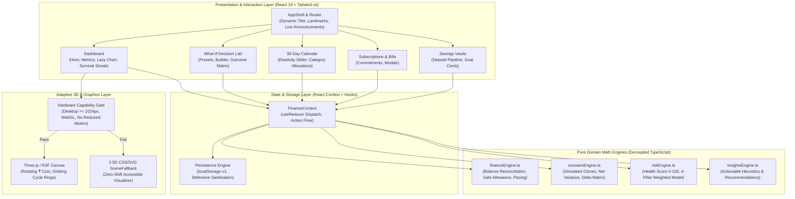

# 🌌 RupeeFlow — Make Every Rupee Count

[](https://www.typescriptlang.org/)
[](https://vitest.dev/)
[](https://eslint.org/)
[](./ACCESSIBILITY.md)
[](./SECURITY.md)
[](./LICENSE)

> **Live Deployment:** [https://rupee-flow-124.netlify.app/](https://rupee-flow-124.netlify.app/)  
> **Team:** `FrontendSmashers` | **Hackathon Track:** *Broke But Functional — Survive the Month*  
> **Repository:** [https://github.com/DhruvPathak767/PromptRun-2026](https://github.com/DhruvPathak767/PromptRun-2026)

---

## 🧭 Quick Links to Architectural Specifications

- 🏗️ **[System Architecture & Data Flow (ARCHITECTURE.md)](./ARCHITECTURE.md)**: Layered design, domain math decoupling, and code splitting topology.
- 🛡️ **[Security Policy & Threat Model (SECURITY.md)](./SECURITY.md)**: XSS tag-stripping, prototype-pollution defenses, and production CSP headers.
- ♿ **[Accessibility & WCAG 2.2 AA Specification (ACCESSIBILITY.md)](./ACCESSIBILITY.md)**: Full keyboard traps, screen reader landmarks, and accessible chart table views.
- 🤝 **[Contributing & Verification Guidelines (CONTRIBUTING.md)](./CONTRIBUTING.md)**: Pre-commit checklists, strict TypeScript guidelines, and test commands.

---

## 🚀 Product Overview

**RupeeFlow** is an interactive personal finance command center designed for Gen Z navigating a strict ₹10,000 monthly budget across 30 days. Rather than functioning as a passive expense tracker, RupeeFlow transforms financial survival into a transparent, gamified decision-making system.

Young adults face recurring commitments, sudden social expenses (e.g. food delivery, sneaker drops, weekend outings), and unpredictable cash cliffs. RupeeFlow provides immediate mathematical clarity, separating illusory cash from **safe discretionary funds**, and features the signature **What-If Decision Lab** to test financial decisions before committing real rupees.

---

## ✨ Signature Features & Gen Z Innovation

### 1. ⚡ Impulse Buy Reality Checker & 24h Cool-Down Chamber
- **The Chai & Meal Index**: Translates any impulse craving (e.g. ₹799 Zomato order or Zara hoodie) into tangible Gen Z units: **40 cups of Tapri Chai ☕** or **6.7 Campus Thali Meals 🍱**.
- **Daily Allowance Destruction Meter**: Computes the exact daily allowance loss across all remaining cycle days.
- **24-Hour Cool-Down Chamber**: Locks impulse temptations in a digital cool-down chamber with a timer (87% of impulse purchases fade after 24 hours).

### 2. 🔥 "Survive the Month" Challenge & Streak Gamification
- **Deterministic Survival Probability**: Real-time score (0–99%) forecasting likelihood of reaching Day 30 without deficit.
- **Cycle Survival Streak**: Tracks consecutive days without budget exhaustion with celebration animations.
- **Gen Z Achievement Badges**: Unlockable milestones (*Discretionary Discipline*, *Zen Cash Buffer*, *Subscription Auditor*, *Vault Builder*).

### 3. ✨ 30-Day Money Vibe Wrap (Spotify-Wrapped Style)
- Generates a personalized Gen Z financial archetype card (*The Chai-Powered Strategist ☕*, *The Vault Builder 🎯*, *The Tactical Pragmatist 🛡️*).
- One-click formatted summary copy for sharing with friends.

### 4. 🧪 What-If Decision Lab (The Core Differentiator)
- Non-destructive hypothetical sandbox deep-cloning current state.
- Side-by-side **Before Decision** vs. **After Decision** comparison across 8 required metrics.
- Plain-language consequence analysis (e.g. explains how a ₹2,499 purchase shrinks daily allowance from ₹394 to ₹263/day).
- One-click **Apply Decision to Ledger** workflow.

### 5. 🪐 Adaptive 3D Rupee Coin & Orbiting Rings
- Original Three.js + React Three Fiber composition featuring a bevelled ₹ coin and orbiting cycle timeline rings.
- **Capability Gated**: Automatically loads only on capable desktop screens (`>= 1024px`) without reduced-motion preferences; displays a lightweight 2.5D `SceneFallback` on mobile to guarantee fast First Contentful Paint.

---

## 📐 System Architecture Diagram



---

## 📊 Mathematical Formulation Specification

All core calculations are implemented as deterministic, pure TypeScript functions:

### 1. Reconciled Cash Balance
$$\text{Cash Balance} = \text{Opening Budget} + \sum \text{Income} - \sum \text{Completed Expenses} - \sum \text{Savings Deposits}$$

### 2. Available Discretionary Funds
$$\text{Discretionary Funds} = \text{Cash Balance} - \sum \text{Upcoming Unpaid Commitments} - \sum \text{Remaining Active Subscriptions} - \sum \text{Outstanding Planned Savings}$$

### 3. Safe Daily Spending Allowance
$$\text{Safe Daily Allowance} = \max\left(0, \left\lfloor \frac{\text{Discretionary Funds}}{\max(1, 30 - \text{Current Day} + 1)} \right\rfloor\right)$$

### 4. Pacing Velocity Ratio
$$\text{Velocity Ratio} = \frac{\text{Actual Daily Average Spend}}{\text{Target Daily Pacing Allowance}}$$

### 5. Explainable 4-Factor Financial Health Index (0–100)
$$\text{Health Score} = S_{\text{discretionary}} \cdot 0.35 + S_{\text{month-end}} \cdot 0.30 + S_{\text{commitments}} \cdot 0.20 + S_{\text{savings}} \cdot 0.15$$

---

## 🛠️ Technology Stack & Dependencies

| Area | Technologies | Rationale |
| :--- | :--- | :--- |
| **Framework** | React 19.2, TypeScript 6.0 | Strict Mode, modern concurrency |
| **Build Tool** | Vite 8.3, Rolldown runtime | Sub-second builds, optimal tree-shaking |
| **Styling** | Tailwind CSS v4, Vanilla CSS variables | Zero-runtime CSS with modern color tokens |
| **Routing** | React Router v7 | Code-split SPA routes with meta listeners |
| **3D Graphics** | Three.js 0.186, React Three Fiber | Hardware-gated 3D composition |
| **Charts** | Recharts 3.10 | Lazy-loaded with accessible table toggle |
| **Linting** | ESLint 9 (Flat Config), Oxlint 1.81 | jsx-a11y, react-hooks, typescript-eslint |
| **Testing** | Vitest 5.0, Testing Library, jsdom | 37 automated tests passing |

---

## 💻 Local Setup & Development

```bash
# 1. Clone the repository
git clone https://github.com/DhruvPathak767/PromptRun-2026.git
cd PromptRun-2026

# 2. Install dependencies
npm install

# 3. Start local development server
npm run dev
# Server ready at http://localhost:5173
```

### Verification & Quality Suite

```bash
# Run both ESLint & Oxlint (0 errors, 0 warnings enforced)
npm run lint

# Run strict TypeScript typecheck
npm run typecheck

# Run all 37 Vitest unit and component tests
npm run test

# Production build with chunk analysis
npm run build
```

---

## 🔒 Security & Privacy Disclosure

- **100% Client-Side Sandbox**: All calculations and simulations run in local browser memory.
- **Zero Live Financial Credentials**: RupeeFlow does not connect to external bank accounts or store credentials.
- **Zero Third-Party Trackers**: No analytics or telemetry scripts.

---

## 📜 License

Distributed under the **MIT License**. See [`LICENSE`](./LICENSE) for details.  
Built with passion by Team **FrontendSmashers** for the 2026 Personal Finance Challenge.
